<p align="center">
  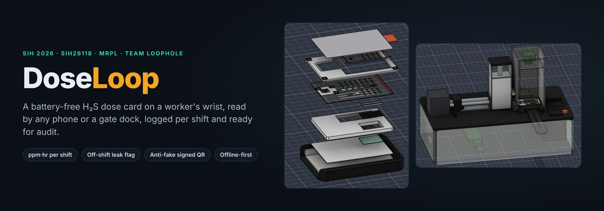
</p>

<p align="center">
  <a href="https://dose-loop.vercel.app"></a>
  <a href="https://github.com/safafibm-ops/DoseLoop/releases/download/apk-latest/DoseLoop.apk"></a>
  <a href="https://dose-loop.vercel.app/project/"></a>
</p>
<p align="center">
  
  
  
  
  
</p>

**DoseLoop** measures how much hydrogen sulphide (H₂S) each worker actually absorbs, shift by shift. A battery-free colorimetric sensor card on a reusable wristband darkens permanently with dose. Any phone, or a gate dock, photographs it at the start and end of every shift. An on-device AI vision pipeline turns the colour into a lighting-corrected dose in **ppm·hr** and logs it against the worker, shift and card, ready for audit.

> **Demo data, lab validation pending.** Doses, colour curve, costs and accuracy figures are design targets until lab calibration with certified H₂S gas.

**Try it in 2 minutes, no card and no login:** open the [live demo](https://dose-loop.vercel.app) → **Try demo** → *Ravi Kumar (worker)*. A guided tour walks through a shift start, shift end, an off-shift leak, a fake card and the supervisor report.

---

## Problems we solved

Occupational H₂S limits are written as a **dose over time** (India: 10 ppm × 8 h = 80 ppm·hr per shift; ACGIH: 8 ppm·hr). Plants mostly measure **peaks**. DoseLoop measures the dose, and works **alongside** gas alarms, not instead of them.

### 1. Colour and lighting correction: the dock and the colour QR

A colour sensor is only as good as its reading. Every phone boosts colour differently, plant lights are yellow or blue, and printers print a little lighter or darker on every roll. We attack this at both ends:

- **Colour QR with measured colours** *(v6 design; the app already corrects against the printed scale)*. At the factory an inline spectrophotometer measures each printed roll, and the **real** measured colours (not the intended ones) go into the card's signed QR. Every photo also carries a 6-step brown scale and colour modules beside the strip, so the app corrects each photo against a chart whose true values it already knows. A held-out brown checks the correction on every scan; a bad photo means a retake.
- **The gate dock** *(v6 design)*. At the shift gate, a closed light box with high-CRI 5000 K LEDs and a fixed Raspberry Pi camera reads every card under the **same light, distance and angle**, so phone and lighting differences disappear. The dock also swaps the card hands-free.
- **Relative reading.** The dose is strip minus reference cell (same ink, same print), so leftover ink and print differences cancel.

<p align="center">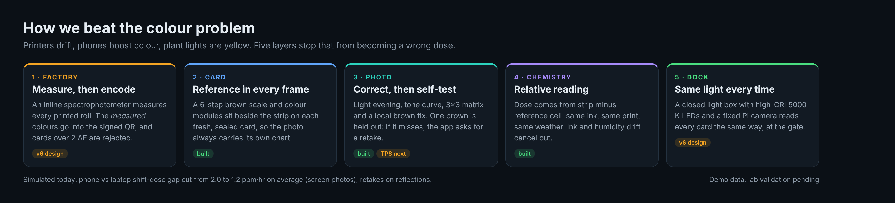</p>

In a simulated cross-device test, the phone-vs-laptop shift-dose gap for screen photos dropped from **2.0 to 1.2 ppm·hr** on average (10.3 to 5.4 at worst), with 43 of 48 differences inside the reported ± range. Details in [docs/TECHNICAL.md](docs/TECHNICAL.md).

### 2. Exposure between shifts

A clear sliding shutter is opened at shift start (green dot) and closed at shift end (red dot). The app compares each start scan with the previous end scan, so any colour change off shift is flagged as a possible leak or misuse. One card therefore gives a separate dose for every shift, not one number at the end of the month.

### 3. Humidity, heat and ageing

Copper-acetate ink reacts slightly to humidity and age. A **reference cell** with the same ink sits under a carbon/ZnO filter that blocks H₂S but lets humidity and heat through. Subtracting it cancels weather and ageing. A **heat dot** (wax melt, ~45 °C) turns dark for good if a card ever overheats, and the app then rejects it.

### 4. Fake, swapped or reused cards

Each card's QR carries its serial, batch and colours, signed with **Ed25519**. The app checks the signature offline, so a copied or edited code fails. The first scan binds the card to one worker, and a tamper stripe shows if it was pulled out.

### 5. Cost

The v5 moulded pod had 11 parts and cost about ₹20–46. The v6 card is made on rolls like a test strip, so the one-time part drops to **₹4–12** and the total to about **₹15–35 per worker per month**, including the band (estimates, not quotes).

### Other gaps we closed

| Gap | Today | DoseLoop |
|---|---|---|
| Per-worker cumulative dose | Electronic monitors alarm on peaks; ₹15,000–40,000 each plus calibration gas | ppm·hr for every worker and every shift |
| Reading colour badges | By eye, in coarse steps, one shift only | Exact dose with a ± range from a 10-second scan |
| Lab samplers | Results take days | Read on site, fully offline |
| Bad photos (glare, screens, tilt, sodium lamps) | Wrong readings | Light evening, glare, reflection and moiré checks force a retake; tilted and upside-down photos are corrected |
| Batteries in hazardous zones | Electronics need charging and approval | Nothing powered on the wrist |
| Handling a reagent card | By hand | Dock peels the foil and swaps the card; the used card goes to a sealed evidence bin |
| Paper registers for audits | Manual and easy to lose | PDF/CSV exposure register (DGMS/OISD style) and a supervisor dashboard |

## Features

| Hardware (v6 design) | Software (built and live) |
|---|---|
| **One-time sensor card**, 28.6 × 40 × 2.7 mm laminate: copper-acetate strip behind 21 × Ø1.0 mm holes and a 2 mm air gap (Fick's-law diffusion) | **Live camera auto-capture**: locks when the 4 markers and QR are found; upload and sample photos too |
| **Reference cell** under carbon/ZnO filter: same ink, no H₂S, cancels humidity, heat and ageing | **Visual scan pipeline**: every step drawn on the photo (markers, warp, QR, patches, correction, self-test, dose) |
| **6-step brown scale + signed colour QR** printed on every card, so each photo carries its own colour chart | **Dose ± range** from a second reading path and leave-one-out refits |
| **Heat dot** (~45 °C wax melt) and **tamper tear stripe** retire mishandled cards | **Shift log**: dose = end − start, off-shift flag, 80 ppm·hr limit, alerts |
| **Reusable wristband**: FKM strap, 316L hardware, antistatic cradle, safety-orange breakaway link, flush UV-blocking shutter | **Supervisor dashboard**: team heatmap, alerts, cards due, worker drill-down |
| **Motorised gate dock**: swaps cards hands-free and reads them in a fixed high-CRI light box | **Exposure register** export as PDF/CSV (DGMS/OISD style); offline IndexedDB; PWA + Android APK |

## Architecture

<p align="center">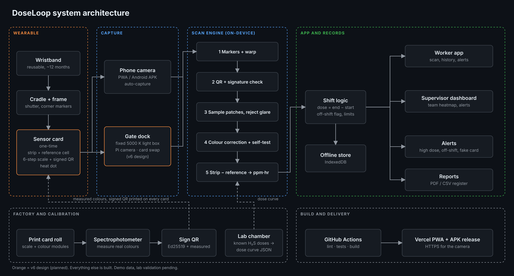</p>

Everything after the photo runs **on the device**: OpenCV.js in a Web Worker, no server, no network after the first load. Card layout and true colours live in one file ([`src/scan/podSpec.json`](src/scan/podSpec.json)) shared by the app and the Python generators, so the printed card and the reader never disagree.

## Screens

<p align="center">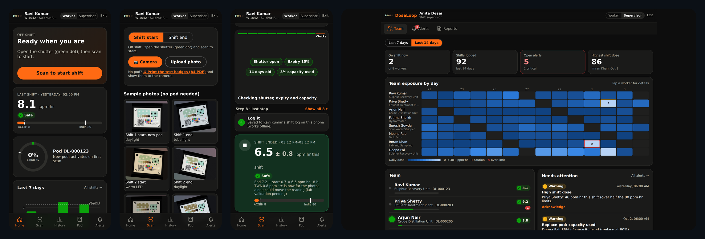</p>
<p align="center"><sub>Worker home · live scan · scan result with every pipeline step · supervisor dashboard</sub></p>

## Tech stack

| Layer | Tools |
|---|---|
| App | React 19, Vite 8, vite-plugin-pwa, Capacitor 8 (Android APK) |
| Vision | OpenCV.js (markers, warp, colour), jsQR + OpenCV QR reader, CIE Lab ΔE |
| Trust | tweetnacl Ed25519 signatures on every card QR |
| Data | IndexedDB (idb-keyval), jsPDF reports, CSV |
| Modelling | Python: NumPy, Pillow, OpenCV, scikit-learn dose curve exported as JSON |
| CAD | Autodesk Fusion 360 (scripted models of band, card and dock) |
| Delivery | GitHub Actions (lint, tests, build, APK release), Vercel (HTTPS for the camera) |

## Run it locally

```bash
npm install
npm run dev      # http://localhost:5173
npm test         # scan pipeline on every sample and adverse photo, shift-log rules
npm run build
```

No card? Print [`public/print/doseloop-test-badges.pdf`](public/print/doseloop-test-badges.pdf) at 100% and point the camera at it.

```text
src/scan/      scan engine: markers, QR + signature, light, colour, pipeline, Web Worker
src/data/      shift logic, limits, seeded demo team, offline store
src/screens/   landing, worker, live scan, supervisor
scripts/       card face generator, dose-curve fit, adverse photo simulator
test/          adverse and cross-device photo tests
docs/          MASTER.md (full design), TECHNICAL.md (scan details)
```

## Hardware evolution: v1 → v6

| | | |
|:---:|:---:|:---:|
| 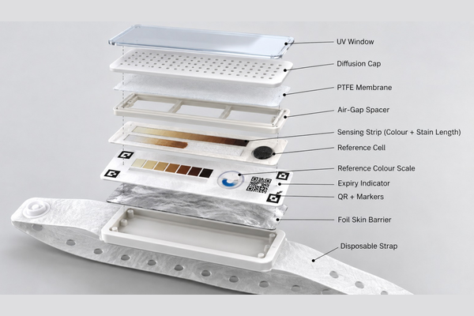<br>**v1 · Concept**<br><sub>Fully disposable strap with a layered stack: UV window, diffusion cap, PTFE membrane, stain-length strip</sub> | 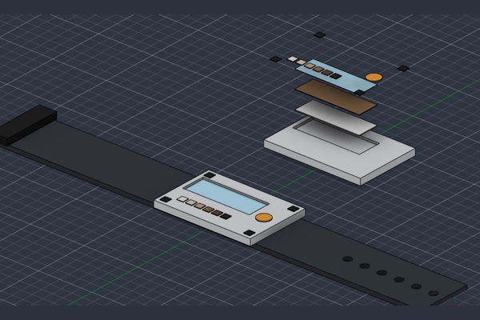<br>**v2 · First CAD**<br><sub>Flat band and a clip-in pod with strip stack, colour scale, markers and expiry patch</sub> | 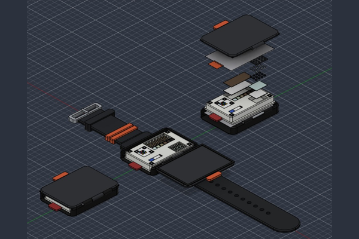<br>**v3–v4 · Reusable band**<br><sub>Buckle strap and cradle with a lid; disposable pod with peel foil and tamper tab</sub> |
| 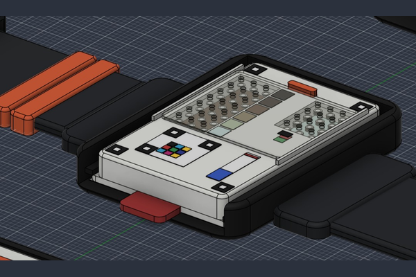<br>**v5 · Flush shutter pod**<br><sub>Sliding hole-shutter, filter dots in the reference cell, FKM straps with breakaway link</sub> | 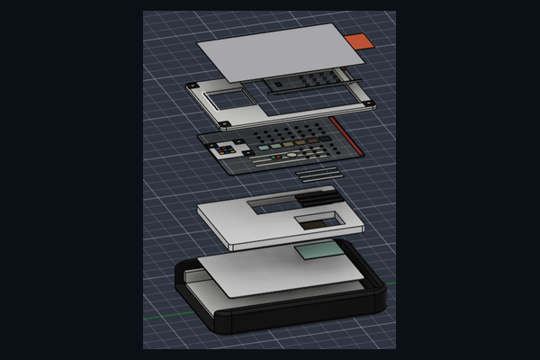<br>**v6 · Sensor card layers**<br><sub>Roll-made one-time card (₹4–12); heat dot replaces the dye-wick</sub> | 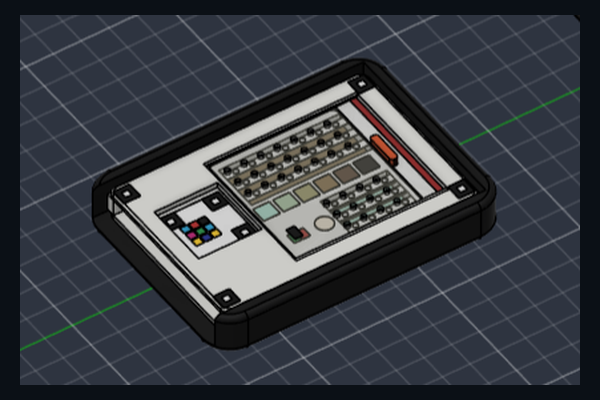<br>**v6 · Card in reusable frame**<br><sub>A new card pushes the old one out; shutter and markers stay on the frame</sub> |
| 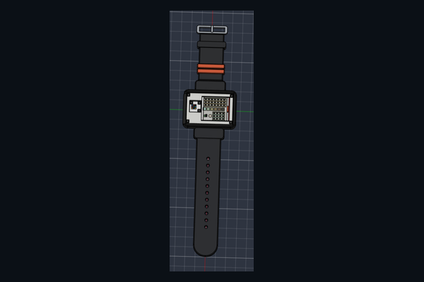<br>**v6 · Worn band**<br><sub>Same reusable band and cradle as v5, with a new exit slot</sub> | 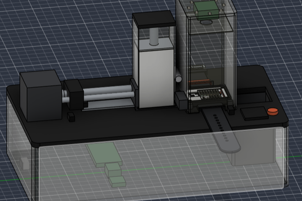<br>**v6 · Motorised dock**<br><sub>Stepper pusher, foil peeler, Pi Zero 2 W camera light box, sealed 25-card magazine</sub> | |

Each step removed a real weakness: a thrown-away band (v1), no shift on/off control (v2), a lid that could snag on machinery (v3–v4), and an expensive 11-part moulded pod (v5).

## Roadmap

- [x] Wristband, pod and card designs v1–v6 in Fusion 360, with bill of materials
- [x] Scan engine, worker and supervisor app, PWA and Android APK, CI on every pull request
- [x] Adverse-photo and cross-device test suite with printable test badges
- [ ] **Lab calibration**: sealed chamber, certified H₂S, 5+ doses from ~1 to 240 ppm·hr; target ±20% of true dose
- [ ] Prove a true dose response (2 ppm × 8 h = 16 ppm × 1 h), humidity 30–90% RH, heat 20–45 °C, 90-day shelf life
- [ ] Update the app to the v6 card face: heat dot, colour modules, thin-plate-spline correction
- [ ] Build the dock prototype (3D-printed housing, Pi Zero 2 W, NEMA 17, N20)
- [ ] JAB Code colour QR carrying the spectro-measured colours
- [ ] Pilot in one MRPL unit, then plant-wide; optional server sync for multi-site supervisors
- [ ] PESO/ATEX certification for hazardous zones; extra high-dose or stain-length lane only if validation needs it

---

<p align="center"><sub>Team LoopHole · Smart India Hackathon 2026 · Problem statement SIH26118 (MRPL)<br>Full design reference: <a href="docs/MASTER.md">docs/MASTER.md</a> · Demo data, lab validation pending</sub></p>
